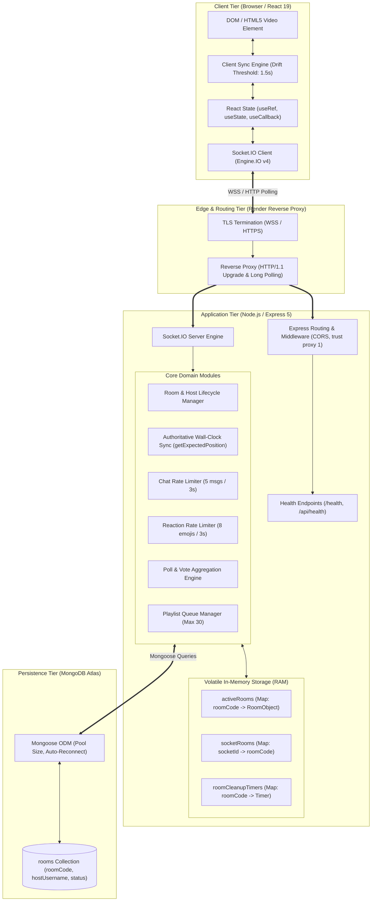
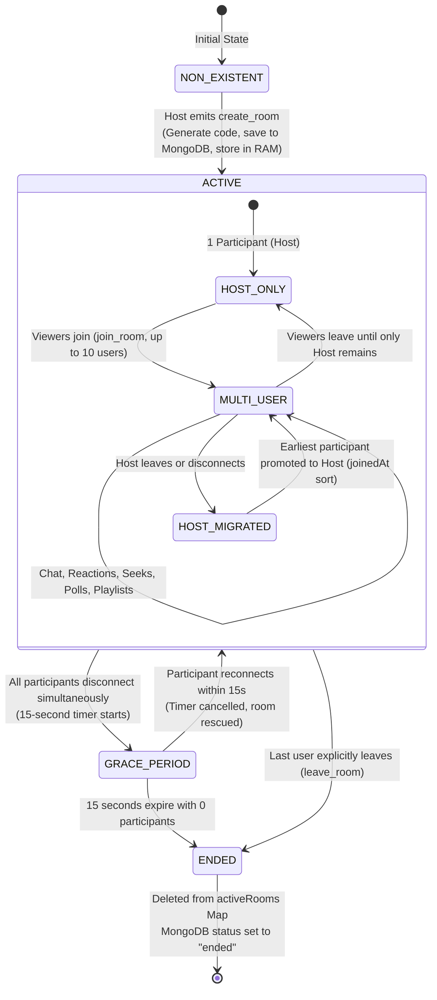
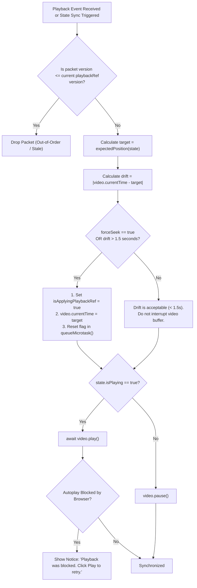
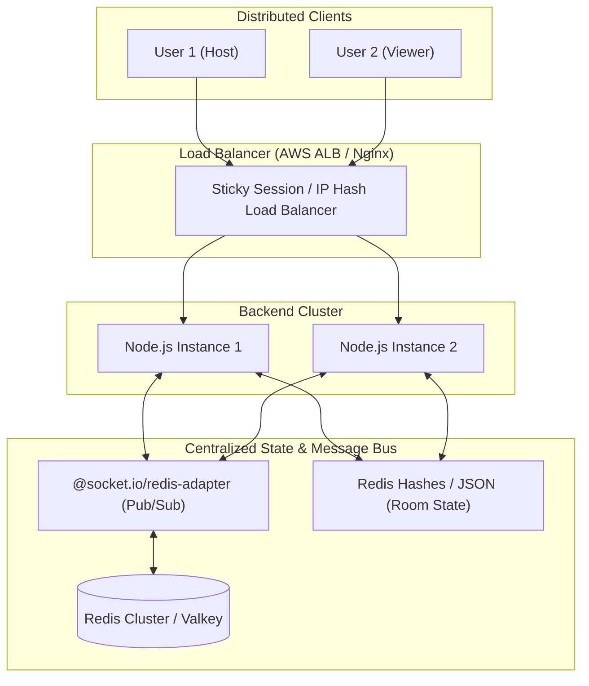

# Watch Party — Deep System Architecture Specification

> **Technical Architecture Guide for Engineering Interviews & System Design**  
> *Target Topics: Distributed State, Real-Time Synchronization, Hybrid Persistence, Network Topologies, Scaling*

---

## 1. High-Level Architectural Paradigm

Watch Party utilizes an **Authoritative Server, Client-Predictive Event-Driven Architecture**. 

The system distributes responsibilities across decoupled tiers:
- **Presentation & Client Engine (Vercel Edge CDN)**: Static Single Page Application (SPA) built with React 19. Runs an event listener loop, manages local UI state, and executes local drift compensation algorithms against the native HTML5 `<video>` element.
- **Real-Time Orchestration & API Layer (Render Cloud Web Service)**: Stateful Node.js and Express 5 server. Hosts the Socket.IO engine, executes authoritative playback calculations, enforces permissions (Host vs Viewer), manages rate-limiting buckets, and houses the primary ephemeral in-memory state.
- **Persistence Tier (MongoDB Atlas Cloud)**: Distributed NoSQL document store. Persists audit and lifecycle metadata for rooms.



---

## 2. In-Memory vs. Database Persistence: The Hybrid State Model

A frequent interview question is:  
> *"Why did you use in-memory Maps for active rooms instead of storing all room state in MongoDB?"*

### Comparative Trade-off Analysis

| Metric | MongoDB Document Updates | Server RAM (`Map` / Object) | Architectural Decision |
| :--- | :--- | :--- | :--- |
| **Operation Latency** | 30ms – 150ms (Network round-trip + disk I/O + B-Tree index updates) | **< 0.05ms** (Direct memory pointer dereference in V8 heap) | **RAM**: Video playback synchronization requires microsecond-level clock reads to prevent playback stuttering. |
| **Write Frequency** | Rapid writes (e.g. 10 users reacting, seeking, chatting) will saturate database connection pools and drive up Atlas tier costs. | Near infinite write throughput within Node's process memory boundary. | **RAM**: Volatile events (floating emojis, typing, seeks) belong in volatile memory. |
| **Data Lifespan** | Long-term durable storage across server crashes and deployments. | Bound to the Node.js process lifetime. | **MongoDB**: Used strictly for room existence audits, historical records, and room code uniqueness. |
| **Memory Footprint** | Externalized storage; zero server RAM used. | Minimal. A fully loaded room with 10 participants, 100 messages, 30 playlist items, and 1 poll consumes **~120 KB** of RAM. | **RAM**: 1,000 active rooms require only ~120 MB of RAM, easily fitting within Render's 512 MB free tier. |

### The Data Division in Watch Party

```
+---------------------------------------------------+---------------------------------------------------+
|               IN-MEMORY STATE (RAM)               |              PERSISTED IN MONGODB                 |
|       (activeRooms & socketRooms in server.js)    |               (Room.js Schema)                    |
+---------------------------------------------------+---------------------------------------------------+
| - Active socket IDs and participant mappings     | - Unique 6-character roomCode                     |
| - Current hostSocketId                            | - hostUsername (Initial creator or promoted host) |
| - Playback snapshot (position, isPlaying, version)| - status ("active" | "ended")                     |
| - Timestamp of last state change (updatedAt)      | - createdAt & updatedAt (Mongoose timestamps)     |
| - In-memory chat history (capped at 100 messages) |                                                   |
| - Shared playlist items (capped at 30 items)      |                                                   |
| - Live active poll, option text, user vote map    |                                                   |
| - Rate limiting sliding windows per socket        |                                                   |
+---------------------------------------------------+---------------------------------------------------+
```

---

## 3. Communication Protocols & Transport Lifecycle

The connection between [`frontend/src/App.jsx`](file:///c:/Users/Ashmit/Vinnovate-recruitment/watch-party/frontend/src/App.jsx#L53) and [`backend/src/server.js`](file:///c:/Users/Ashmit/Vinnovate-recruitment/watch-party/backend/src/server.js#L146) uses **Socket.IO Engine.IO v4**:

```mermaid
sequenceDiagram
    autonumber
    actor Client as React Client (Browser)
    participant LB as Render Reverse Proxy
    participant Server as Socket.IO Server (Node.js)

    Note over Client, Server: Phase 1: HTTP Long-Polling Handshake
    Client->>LB: GET /socket.io/?EIO=4&transport=polling&t=xyz
    LB->>Server: Forward Handshake Request
    Server->>Server: Generate SID (Session ID: e.g. "x8Ab...")
    Server-->>Client: 200 OK: { sid: "x8Ab...", upgrades: ["websocket"], pingInterval: 25000, pingTimeout: 20000 }
    
    Note over Client, Server: Phase 2: Long-Polling Data Exchange (Immediate Fallback Readiness)
    Client->>LB: POST /socket.io/?EIO=4&transport=polling&sid=x8Ab... (payload)
    Server-->>Client: 200 OK (Ack)

    Note over Client, Server: Phase 3: WebSocket Upgrade Verification
    Client->>LB: GET /socket.io/?EIO=4&transport=websocket&sid=x8Ab... (Upgrade: websocket)
    LB->>Server: WebSocket Handshake HTTP 101 Switching Protocols
    Server-->>Client: HTTP 101 Switching Protocols
    Client->>Server: WebSocket probe packet ("2probe")
    Server-->>Client: WebSocket probe response ("3probe")
    
    Note over Client, Server: Phase 4: Full-Duplex WebSocket Active
    Client->>Server: Close polling channel; all events switch to WSS frames
```

### Why Start with Long-Polling Instead of Direct WebSocket?
1. **Corporate Firewalls and Restrictive Proxies**: Some enterprise, school, or mobile carrier networks inspect HTTP traffic and aggressively drop direct WebSocket upgrade headers (`Upgrade: websocket`). By initiating over HTTP long-polling, connection establishment is 100% reliable.
2. **Reverse Proxy Buffering**: Cloud hosting platforms like Render or AWS ALBs sometimes experience handshake delays or misconfigurations on direct WebSocket connections. Socket.IO verifies that WebSocket works via a `probe` frame before severing the HTTP polling transport.

---

## 4. Room Lifecycle State Machine

A room transitions through clearly defined lifecycle states managed in [`backend/src/server.js`](file:///c:/Users/Ashmit/Vinnovate-recruitment/watch-party/backend/src/server.js#L401-L464):



### Deep Dive: Disconnect vs. Explicit Leave
- **Explicit Leave (`leave_room`)**: The user clicks "Leave Room". If `room.participants.size === 0`, the room is destroyed immediately. There is no need for a grace period because the departure was intentional.
- **Accidental Disconnect (`disconnect`)**: Caused by page refreshes, mobile screen locks, or network jitter. The backend checks `if (room.participants.size === 0)` and triggers a **15-second grace period timer** stored in `roomCleanupTimers`. If a client issues `reconnect_room` within 15 seconds, the timer is cleared and the room's playback and chat state are fully preserved.

---

## 5. Playback Synchronization & Drift Control Engine

The video synchronization system ensures that all viewers maintain frame-accurate or near-frame-accurate playback with the host, without continuous network flooding.

### The Authoritative Wall-Clock Algorithm

Instead of transmitting continuous timecode updates (e.g. 60 times a second), the server only broadcasts state transitions:
1. **Play**: Host starts playback. Server records `position` and timestamps the action with `updatedAt = Date.now()`.
2. **Pause**: Host pauses. Server calculates elapsed play time, freezes `position`, and sets `isPlaying = false`.
3. **Seek**: Host jumps to timestamp $T$. Server updates `position = T`, `updatedAt = Date.now()`.
4. **Ended**: Video reaches duration. Server updates `isPlaying = false`.

#### Mathematical Formulation

On any client or on the server, the expected playback position $P_{\text{expected}}$ at wall-clock time $t_{\text{now}}$ is defined as:

$$P_{\text{expected}}(t_{\text{now}}) = 
\begin{cases} 
P_{\text{anchor}} & \text{if } \text{isPlaying} = \text{false} \\ 
P_{\text{anchor}} + \frac{\max(0, t_{\text{now}} - t_{\text{updated}})}{1000} & \text{if } \text{isPlaying} = \text{true} 
\end{cases}$$

Where:
- $P_{\text{anchor}}$ is `playback.position` stored at the last state transition.
- $t_{\text{updated}}$ is `playback.updatedAt` (Unix epoch milliseconds).
- $t_{\text{now}}$ is the current client system time (`Date.now()`).

### Drift Correction Decision Flowchart

When an update arrives or periodic checks occur in [`frontend/src/WatchPlayer.jsx`](file:///c:/Users/Ashmit/Vinnovate-recruitment/watch-party/frontend/src/WatchPlayer.jsx#L44-L82):



### Race Condition Protections in Video Sync
1. **The Recursive Seek Trap (`isApplyingPlaybackRef`)**:
   - In HTML5 video, setting `video.currentTime = target` immediately triggers the browser's native `onTimeUpdate` and `onSeeking` events.
   - If an application is not careful, the client might interpret this browser event as a manual user seek and fire a `playback_command` back to the server, creating an infinite echo loop.
   - **Solution in Code**: Before mutating `video.currentTime`, [`WatchPlayer.jsx`](file:///c:/Users/Ashmit/Vinnovate-recruitment/watch-party/frontend/src/WatchPlayer.jsx#L57) sets `isApplyingPlaybackRef.current = true`. The `onTimeUpdate` listener immediately aborts if this flag is true. The flag is reset asynchronously inside `queueMicrotask()`.
2. **Monotonic Versioning (`version` counter)**:
   - Network packets can arrive out of order (e.g. a rapid "Play" followed immediately by "Pause").
   - If the "Play" packet experiences network jitter and arrives after "Pause", a naive client would execute "Play" and desync.
   - **Solution in Code**: The server increments `room.playback.version` on every state transition. Clients discard any incoming playback update where `state.version <= previous.version`.

---

## 6. Security, Networking, & Reverse Proxy Topology

### 1. Reverse Proxy & Trust Proxy
When deployed on Render, incoming client requests pass through Render's TLS termination reverse proxy (Nginx / Cloudflare layer) before reaching the Node.js application.
- The real client IP is passed in the `x-forwarded-for` header.
- In [`backend/src/server.js`](file:///c:/Users/Ashmit/Vinnovate-recruitment/watch-party/backend/src/server.js#L103), `app.set("trust proxy", 1)` is configured. Without this, Express treats the reverse proxy's internal private IP as the client IP, breaking IP-based logging, auditing, and rate-limiting.

### 2. Dynamic CORS with Wildcard Matching
Standard CORS libraries only support exact origin strings or unconditional `*`. In modern deployment workflows, frontend preview deployments on Vercel generate dynamic URLs (e.g. `https://watch-party-git-feature-ash-c968.vercel.app`).
- The application implements a custom origin evaluator [`isOriginAllowed()`](file:///c:/Users/Ashmit/Vinnovate-recruitment/watch-party/backend/src/server.js#L56-L76).
- It parses wildcard patterns like `https://*.vercel.app`, converts them to regex:
  ```javascript
  const regexStr = target
    .split("*")
    .map((part) => part.replace(/[.+?^${}()|[\]\\]/g, "\\$&"))
    .join("[a-z0-9_.-]+");
  const pattern = new RegExp(`^${regexStr}$`, "i");
  ```
- This securely allows both production and preview URLs while blocking unauthorized third-party origins.

### 3. Application-Level Rate Limiting
To prevent denial-of-service (DoS) and spam attacks over open WebSocket connections:
- **Chat**: Enforces a sliding window rate limit of **5 messages per 3 seconds** per socket ID via `checkRateLimit(chatRateLimits, socket.id, 5, 3000)`.
- **Reactions**: Enforces a sliding window rate limit of **8 reactions per 3 seconds** per socket ID via `checkRateLimit(reactionRateLimits, socket.id, 8, 3000)`.
- Timestamps are cleaned and pruned on every check to prevent memory leakage.

### 4. Input Sanitization & Injection Defense
- **Room Code**: Strict alphanumeric regex `/^[A-Z0-9]{6}$/`.
- **Username**: Sanitized via regex `cleanUsername` to reject non-printable characters and HTML injection characters (`/[\u0000-\u001F\u007F<>]/`).
- **Video URLs**: Validated using Node's `new URL(urlString)` to ensure protocol is strictly `http:` or `https:`, preventing `javascript:` or `data:` URI attacks.

---

## 7. Scaling to Multiple Backend Instances (Horizontal Scaling)

In its current state, **Watch Party is intentionally optimized as a single-instance backend**:
- All room state, participant socket IDs, and playback timers exist in the server's local RAM (`Map`).
- If a second Render instance were spawned, users connected to Instance A could not communicate with or synchronize with users connected to Instance B.

### How to Scale Horizontally (The Production Roadmap)

To scale this application across multiple backend nodes behind a load balancer, three architectural changes would be required:



1. **Socket.IO Redis Adapter (`@socket.io/redis-adapter`)**:
   - Replaces the in-memory event emitter. When Instance 1 emits `io.to("ROOM123").emit("playback_updated")`, the Redis adapter publishes the event to a Redis channel. Instance 2 receives the Redis message and broadcasts it to its locally connected sockets.
2. **Externalized Shared State (Redis Hashes / Valkey)**:
   - The in-memory `activeRooms` Map is moved to Redis (using Redis Hashes or RedisJSON).
   - Expected position updates and playback locks are handled via atomic Redis commands (`HSET`, `HGET`) or Lua scripts to prevent concurrent update collisions.
3. **Sticky Sessions (Session Affinity)**:
   - Load balancers must route HTTP long-polling handshake requests from the same client to the same backend server instance until the WebSocket upgrade is established.
