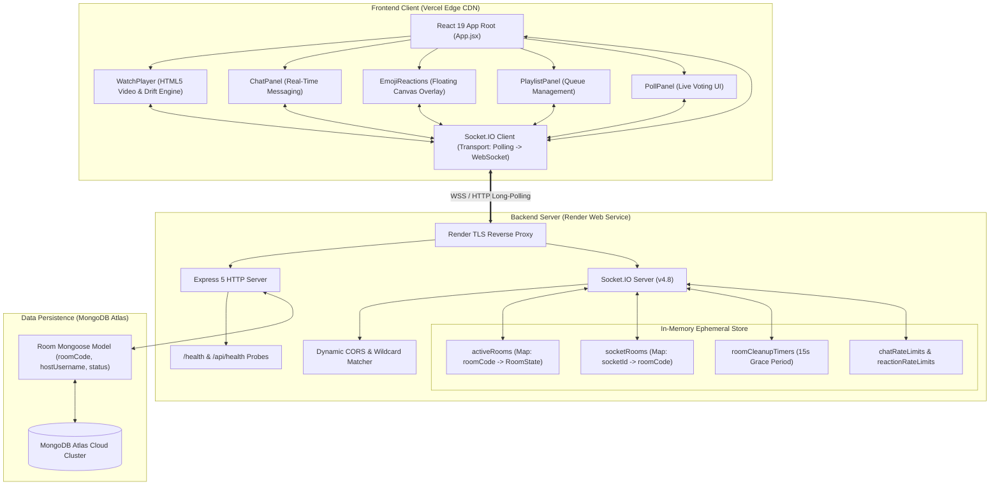

# Watch Party — Comprehensive Project Overview & System Analysis

> **Authoritative Technical Guide for Interview Preparation**  
> *Target Roles: Full Stack Engineer, Frontend Engineer, Backend / Real-Time Systems Engineer*  
> *Repository Base: `watch-party` (React 19, Node.js / Express 5, Socket.IO 4.8, MongoDB Atlas)*

---

## 1. What Problem the Application Solves

In a distributed, remote-first world, watching video content synchronously with friends or family across different physical locations presents significant challenges:

1. **Playback Asynchrony**: Manually pressing "play" over a phone call or Discord voice channel results in divergence within seconds due to differences in buffering speed, video startup latency, and human timing error.
2. **Interactive Disconnect**: Users often have to juggle multiple windows (a video streaming site, a Discord/WhatsApp chat, and a polling app) to discuss what they are watching or decide what to watch next.
3. **Complex Setup & Account Friction**: Many commercial watch-party browser extensions require account creation, extension installation with high permissions, identical browser platforms, or paid subscriptions.

**Watch Party solves this by providing a zero-install, browser-native, synchronized streaming room** where:
- A host creates a private room identified by a unique 6-character alphanumeric code.
- Viewers join via code or a single direct link (`/?room=CODE`).
- Video playback (play, pause, seek, video selection) is synchronized across all clients using an authoritative server clock model with automatic client-side drift compensation.
- Social interactions—real-time chat, floating emoji reactions, collaborative playlists, and live polls—are embedded directly beside the player in a unified, responsive interface.

---

## 2. Target Users and Use Cases

| User Group | Use Case | Why Watch Party Fits |
| :--- | :--- | :--- |
| **Friends & Long-Distance Couples** | Movie nights, TV series binge sessions, anime viewing. | Frictionless link sharing, integrated live chat, expressive floating reactions without needing third-party extensions. |
| **Study Groups & Classrooms** | Watching educational lectures, documentaries, or tutorials together. | The host controls playback to pause for explanations, and uses live polls to quiz viewers or check understanding. |
| **Creative Teams & Content Reviewers** | Synchronous review of video drafts, animatics, or commercial cuts. | Seek synchronization allows teams to jump to specific timestamps together and discuss them in the real-time chat. |

---

## 3. Technology Stack Analysis & Rationale

| Technology | Layer | Version in Repo | Why It Was Chosen Over Alternatives |
| :--- | :--- | :--- | :--- |
| **React** | Frontend UI Framework | `^19.2.8` | Declarative component model, robust reconciliation algorithm, hooks for managing external WebSocket subscriptions (`useEffect`), and fine-grained UI reactivity for fast-updating video playback states. |
| **Vite** | Frontend Build Tool | `^8.3.0` | Sub-second Hot Module Replacement (HMR) powered by native ES modules during development, optimized Rollup bundling for production, and minimal configuration compared to legacy Webpack. |
| **Node.js** | Backend Runtime | `>=18.0.0` (ESM `"type": "module"`) | Non-blocking, event-driven asynchronous I/O runtime perfectly tailored for high-concurrency, I/O-bound real-time WebSocket applications. Single-threaded event loop eliminates thread concurrency locks. |
| **Express** | Web Framework | `^5.3.0` | Lightweight HTTP routing, robust middleware pipeline (CORS, body parsing), health-check endpoints for cloud orchestrator monitoring, and native integration with Node's `http.createServer`. |
| **Socket.IO** | Real-Time Engine | `^4.8.4` (Client & Server) | Sits on top of Engine.IO. Provides HTTP long-polling fallback, automatic transport upgrading to WebSocket (`wss://`), built-in room abstractions (`socket.join`), acknowledgments, and automatic reconnection with exponential backoff. |
| **MongoDB & Mongoose** | Database & ODM | `^9.11.2` | Document database for persisting room metadata, host history, and lifecycle status (`active` vs `ended`). Schema flexibility and native TTL / query capabilities. |
| **Render** | Backend Cloud Hosting | Cloud PaaS (Linux container) | Native support for persistent Node.js services with WebSockets, health-check probes (`/health`), and automated deployment from Git. |
| **Vercel** | Frontend Cloud Hosting | Global Edge CDN | Instant global static asset distribution, zero-config single-page application routing (`vercel.json`), and automatic SSL certificates. |

---

## 4. Architectural Overview

The application follows a **Decoupled Client-Server Architecture** with **Hybrid State Management**:

```
[ Vercel Edge CDN ]                     [ Render Cloud Web Service ]               [ MongoDB Atlas ]
+-------------------------+             +----------------------------------+       +-------------------+
| React 19 Client (SPA)   | <=========> | Node.js + Express 5 Server       | <===> | Room Collection   |
| - Custom HTML5 Player   |  Socket.IO  | - Socket.IO Engine               |  TCP  | - roomCode        |
| - Chat & Reaction Panels|  (WSS/HTTP) | - In-Memory Room Map             |  TLS  | - hostUsername    |
| - Playlist & Poll UI    |             | - Authoritative Playback Clock   |       | - status (active) |
+-------------------------+             +----------------------------------+       +-------------------+
```

### Key Architectural Principle: Hybrid State Model
A critical design decision in this repository is the separation of **ephemeral real-time state** from **persistent metadata**:
1. **In-Memory State (`activeRooms` Map in `backend/src/server.js`)**:
   - Stores fast-changing, volatile data: participant lists, active socket IDs, authoritative playback state (`position`, `isPlaying`, `updatedAt`, `version`), playlist queues, active polls, and recent chat history (capped at 100 messages).
   - **Why?** Writing every video pause, seek, chat message, and reaction to MongoDB would introduce severe database I/O bottlenecks and unacceptable latency (50–200ms) for real-time video sync. In-memory operations execute in microseconds.
2. **Persistent State (MongoDB `Room` Model in `backend/src/models/Room.js`)**:
   - Stores room audit metadata: unique `roomCode`, initial and transferred `hostUsername`, and room status (`active` or `ended`).
   - Guarantees room code uniqueness across restarts and maintains an audit trail.

---

## 5. How React Communicates with Express

Communication between React and the backend operates through two distinct channels:

1. **HTTP REST Endpoints (Express)**:
   - `GET /health` and `GET /api/health`: Handled by `healthCheckHandler` in [`backend/src/server.js`](file:///c:/Users/Ashmit/Vinnovate-recruitment/watch-party/backend/src/server.js#L122-L141).
   - Used by Render health-check monitors and deployment testing suites to verify process uptime, database connectivity (`mongoose.connection.readyState === 1`), and active room count.
2. **WebSocket & Long-Polling Channel (Socket.IO)**:
   - Configured in [`frontend/src/App.jsx`](file:///c:/Users/Ashmit/Vinnovate-recruitment/watch-party/frontend/src/App.jsx#L53-L152) using `io(API_URL, { transports: ["polling", "websocket"] })`.
   - All user actions (creating rooms, joining, chat, video controls, polling, reactions) flow entirely over this persistent bi-directional channel via named event emissions with acknowledgment callbacks.

---

## 6. How Socket.IO Establishes & Maintains Real-Time Communication

```
Client (React)                                                     Server (Node.js/Socket.IO)
      |                                                                       |
      | 1. HTTP GET /socket.io/?EIO=4&transport=polling                       |
      |---------------------------------------------------------------------->|
      |                                                                       |
      | 2. HTTP 200 OK (Handshake: sid, pingInterval, pingTimeout, upgrades) |
      |<----------------------------------------------------------------------|
      |                                                                       |
      | 3. WebSocket Upgrade Request (GET /socket.io/?EIO=4&transport=websocket)|
      |---------------------------------------------------------------------->|
      |                                                                       |
      | 4. HTTP 101 Switching Protocols (Connection upgraded to WebSocket)    |
      |<----------------------------------------------------------------------|
      |                                                                       |
      | <==== Bi-directional binary/text WebSocket Frames (Ping / Pong / Data)|
```

1. **Initial Handshake**: The client starts with an HTTP long-polling request. This ensures that firewalls, corporate proxies, and cloud load balancers (like Render's reverse proxy) that might buffer or block direct WebSocket handshakes still establish an initial connection.
2. **Transport Upgrade**: Once the handshake completes and assigns a session ID (`sid`), the client tests if a direct WebSocket connection can be established. If successful, Socket.IO upgrades the transport to `websocket`, dramatically reducing per-message overhead and latency.
3. **Heartbeat / Keepalive**: Socket.IO sends periodic ping/pong packets between client and server. If the server misses heartbeats, it flags the socket as disconnected.
4. **Reconnection Strategy**: In [`frontend/src/App.jsx`](file:///c:/Users/Ashmit/Vinnovate-recruitment/watch-party/frontend/src/App.jsx#L54-L60), the client is configured with `reconnectionAttempts: 15` and `reconnectionDelay: 1000`. If network drops occur, the client retries automatically and restores its room membership via `reconnect_room`.

---

## 7. How MongoDB is Used in the Actual Implementation

- **Connection Setup**: In [`backend/src/server.js`](file:///c:/Users/Ashmit/Vinnovate-recruitment/watch-party/backend/src/server.js#L1450-L1475), `startServer()` validates `process.env.MONGODB_URI` and executes a 3-attempt retry loop with `serverSelectionTimeoutMS: 5000`.
- **Mongoose Schema** ([`backend/src/models/Room.js`](file:///c:/Users/Ashmit/Vinnovate-recruitment/watch-party/backend/src/models/Room.js#L4-L28)):
  ```javascript
  const roomSchema = new mongoose.Schema({
    roomCode: { type: String, required: true, unique: true, uppercase: true, trim: true, match: /^[A-Z0-9]{6}$/ },
    hostUsername: { type: String, required: true, trim: true },
    status: { type: String, enum: ["active", "ended"], default: "active" }
  }, { timestamps: true });
  ```
- **Lifecycle Invocations**:
  1. **Room Creation**: `Room.create({ roomCode, hostUsername, status: "active" })` persists the room when `create_room` succeeds.
  2. **Unique Code Verification**: `Room.exists({ roomCode: code })` ensures randomly generated 6-character codes never collide with previously stored rooms.
  3. **Host Migration**: `Room.updateOne({ roomCode }, { $set: { hostUsername: nextHost.username } })` updates the record if the primary host departs.
  4. **Room Teardown**: `Room.updateOne({ roomCode }, { $set: { status: "ended" } })` marks the room ended after all participants leave or after the 15-second grace period expires.

---

## 8. Room Creation, Joining, and Participant Management

1. **Code Generation**: [`createRoomCode()`](file:///c:/Users/Ashmit/Vinnovate-recruitment/watch-party/backend/src/server.js#L304-L314) generates a 6-character code using cryptographically secure random integers (`crypto.randomInt`) sampled from a 31-character set `ABCDEFGHJKLMNPQRSTUVWXYZ23456789` (excluding ambiguous characters like `0`, `O`, `1`, `I`).
2. **Participant Validation**: Usernames are cleaned (`cleanUsername`) to enforce 2–24 characters and reject control codes or HTML injection characters (`/[\u0000-\u001F\u007F<>]`).
3. **Room Isolation**: The server adds the client socket to the Socket.IO internal room (`socket.join(roomCode)`). This allows targeted broadcasting via `io.to(room.roomCode).emit(...)`.
4. **Capacity Enforcement**: Rooms enforce `MAX_PARTICIPANTS = 10`. New joins exceeding 10 are rejected with an error acknowledgment.
5. **Host Migration**: If the current host leaves or disconnects, the server sorts remaining participants by their arrival timestamp (`joinedAt`) and designates the earliest participant as the new host.
6. **Disconnection Grace Period**: If all participants disconnect (e.g., refreshing or brief Wi-Fi outage), a 15-second timer (`roomCleanupTimers`) starts. If someone reconnects within 15 seconds, the timer is cleared and the room remains active. Otherwise, the room is deleted from memory and marked `ended` in MongoDB.

---

## 9. How Video Playback Synchronization Works

The synchronization engine uses an **Authoritative Wall-Clock Server Model with Client-Side Drift Correction**:

1. **Server Playback State**:
   ```javascript
   room.playback = {
     videoUrl: "...",
     position: 0,        // Timestamp at last state change
     isPlaying: false,   // Current play/pause status
     updatedAt: 1713400000000, // Unix epoch ms of last state change
     version: 1          // Monotonically increasing sequence number
   };
   ```
2. **Calculating Expected Position**:
   When playing, the real position advances continuously. Rather than broadcasting 10 times a second, the server and clients calculate the expected position on the fly:
   $$\text{expectedPosition} = \text{playback.position} + \frac{\max(0, \text{Date.now()} - \text{playback.updatedAt})}{1000}$$
3. **Client Drift Detection** ([`frontend/src/WatchPlayer.jsx`](file:///c:/Users/Ashmit/Vinnovate-recruitment/watch-party/frontend/src/WatchPlayer.jsx#L44-L82)):
   - A threshold is defined: `const DRIFT_THRESHOLD = 1.5;` (seconds).
   - When a playback update arrives, the client compares `video.currentTime` to `expectedPosition(state)`.
   - If $|\text{video.currentTime} - \text{target}| > 1.5\text{s}$ or if `forceSeek` is true, the client seeks `video.currentTime = target`.
   - If drift is under 1.5s, the video continues playing smoothly without jarring micro-seeks.
4. **Loop & Race Condition Prevention**:
   - `isApplyingPlaybackRef.current = true`: Set while updating `video.currentTime` so that the video element's native `onTimeUpdate` event does not misinterpret the programmatic jump as user seeking.
   - `version` counter: Both server and client reject out-of-order or stale playback packets (`state.version <= previous.version`).

---

## 10. Deployment Architecture (Vercel & Render)

```
       User Browser (HTTPS)
          |              |
          | Assets       | WebSocket & API
          v              v
   +--------------+   +-------------------+
   | Vercel Edge  |   | Render Web Service|
   | (React SPA)  |   | (Node.js Server)  |
   +--------------+   +-------------------+
                               |
                               | Mongoose (TLS)
                               v
                      +-------------------+
                      | MongoDB Atlas     |
                      | (Cloud Database)  |
                      +-------------------+
```

- **Frontend on Vercel**: Builds using `vite build` into `frontend/dist/`. Configured with [`frontend/vercel.json`](file:///c:/Users/Ashmit/Vinnovate-recruitment/watch-party/frontend/vercel.json) to rewrite all routes to `/index.html` for single-page routing.
- **Backend on Render**: Linux container executing `node src/server.js` on port `10000`. Configured with `app.set("trust proxy", 1)` to correctly inspect client IPs and headers behind Render's reverse proxy.
- **CORS Negotiation**: The backend dynamically matches origins against `ALLOWED_ORIGINS` and `CLIENT_URL` supporting regex wildcards like `https://*.vercel.app` so pull request preview branches on Vercel work automatically.

---

## 11. System Architecture Diagram



---

## 12. End-to-End Sequence Diagram

```mermaid
sequenceDiagram
    autonumber
    actor Host as Host (Client A)
    participant Server as Node.js / Socket.IO Server
    participant DB as MongoDB Atlas
    actor Viewer as Viewer (Client B)

    %% 1. Room Creation Flow
    Note over Host, DB: 1. Room Creation Flow
    Host->>Server: socket.emit("create_room", { username: "Ashmit" })
    Server->>Server: Validate username & generate unique roomCode (e.g. "WXYZ99")
    Server->>DB: Room.create({ roomCode: "WXYZ99", hostUsername: "Ashmit", status: "active" })
    DB-->>Server: Room record saved
    Server->>Server: Initialize activeRooms["WXYZ99"] in RAM
    Server->>Host: socket.join("WXYZ99")
    Server-->>Host: ack({ ok: true, room: publicRoomSnapshot })
    Server->>Host: emit("room_updated", publicRoomSnapshot)

    %% 2. Viewer Joining Flow
    Note over Viewer, Server: 2. Viewer Joining Flow
    Viewer->>Server: socket.emit("join_room", { username: "Alex", roomCode: "WXYZ99" })
    Server->>Server: Validate room existence, capacity (<10), unique username
    Server->>Server: Add Viewer socket to activeRooms["WXYZ99"].participants
    Server->>Viewer: socket.join("WXYZ99")
    Server-->>Viewer: ack({ ok: true, room: publicRoomSnapshot })
    Server->>Host: emit("room_updated", updatedRoomSnapshot)
    Server->>Viewer: emit("room_updated", updatedRoomSnapshot)

    %% 3. Playback Synchronization Flow
    Note over Host, Viewer: 3. Synchronized Playback Flow (Play Command)
    Host->>Server: socket.emit("playback_command", { action: "play", position: 42.5 })
    Server->>Server: Verify Host permissions (socket.id === room.hostSocketId)
    Server->>Server: Update room.playback (isPlaying=true, position=42.5, updatedAt=now, version++)
    Server-->>Host: ack({ ok: true, playback: snapshot })
    Server->>Host: emit("playback_updated", snapshot)
    Server->>Viewer: emit("playback_updated", snapshot)
    
    Note over Viewer: Drift check: abs(currentTime - expectedPosition) > 1.5s
    Viewer->>Viewer: video.currentTime = 42.5 + elapsed; video.play()
```

---

## 13. File and Directory Manifest

| Path | Purpose & Role | Key Responsibilities |
| :--- | :--- | :--- |
| `backend/src/server.js` | Main Backend Entrypoint | HTTP server bootstrap, Express setup, CORS wildcard resolution, health check endpoints, Socket.IO event listeners, in-memory room management, playback clock synchronization, rate limiting, and graceful disconnect handling. |
| `backend/src/models/Room.js` | MongoDB Mongoose Schema | Schema definition for room codes, host display names, room statuses (`active`/`ended`), and automated timestamp management. |
| `backend/test_suite.js` | Automated Integration Test Suite | Automated end-to-end verification covering room creation, viewer joining, permission enforcement, playback sync, chat broadcasting, reactions, playlists, polls, and socket reconnections. |
| `backend/.env.example` | Backend Config Template | Documents required environment variables (`PORT`, `HOST`, `CLIENT_URL`, `ALLOWED_ORIGINS`, `MONGODB_URI`). |
| `backend/package.json` | Backend Dependency Manifest | Defines dependencies (`express`, `socket.io`, `mongoose`, `cors`, `dotenv`) and execution scripts (`npm start`, `npm run dev`, `npm test`). |
| `frontend/src/App.jsx` | Primary React Application Root | Connection management, global socket event routing, room creation/joining forms, active tab navigation, unread chat counters, and invite link generation. |
| `frontend/src/WatchPlayer.jsx` | Video Streaming & Sync Component | HTML5 video element wrapper, custom playback control bar, authoritative drift correction engine, seek buffering protection, and reaction overlay mounting. |
| `frontend/src/components/ChatPanel.jsx` | Real-Time Chat Component | Message history display, auto-scroll management with "Jump to Bottom" helper, multiline text input, unread count tracking, and input length validation. |
| `frontend/src/components/EmojiReactions.jsx` | Ephemeral Reactions Component | Renders the reaction button bar and the floating CSS animated emoji overlay across the video screen with self-cleaning timers. |
| `frontend/src/components/PlaylistPanel.jsx` | Collaborative Queue Component | Queue management UI allowing the host to add direct video URLs, reorder queue items up/down, remove videos, or immediately switch active playback. |
| `frontend/src/components/PollPanel.jsx` | Interactive Polling Component | Poll authoring form for hosts (2–5 options), real-time voting buttons for viewers, and dynamic percentage/vote count visualization bars. |
| `frontend/vercel.json` | Vercel Deployment Configuration | Configures SPA catch-all rewrites (`/(.*) -> /index.html`) to support client-side routing and direct room URL parameter handling. |
| `frontend/vite.config.js` | Vite Build Configuration | Configures Vite build settings and the official `@vitejs/plugin-react` plugin. |
| `render.yaml` | Render Blueprint Specification | Declarative infrastructure-as-code blueprint defining the backend web service, build/start commands, health-check probe, and environment defaults. |
| `DEPLOYMENT.md` | Public Deployment Guide | Step-by-step instructions for deploying to MongoDB Atlas, Render, and Vercel, including CORS linkage and troubleshooting. |
| `README.md` | Repository Documentation | Project overview, feature matrices, setup instructions for single/multiple laptops, environment reference, and testing checklists. |
